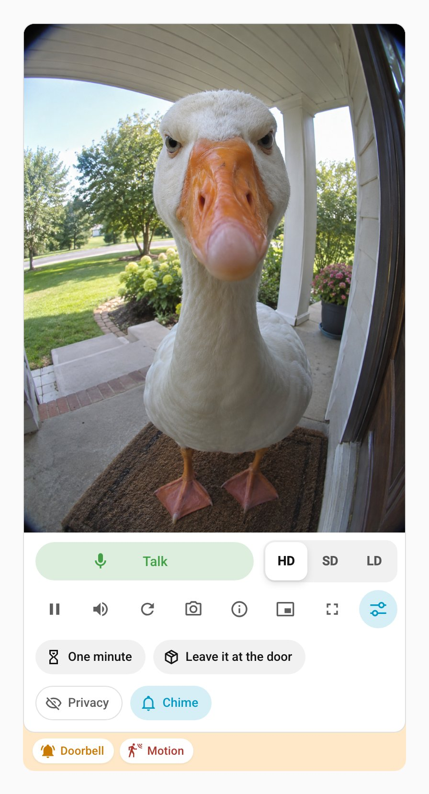
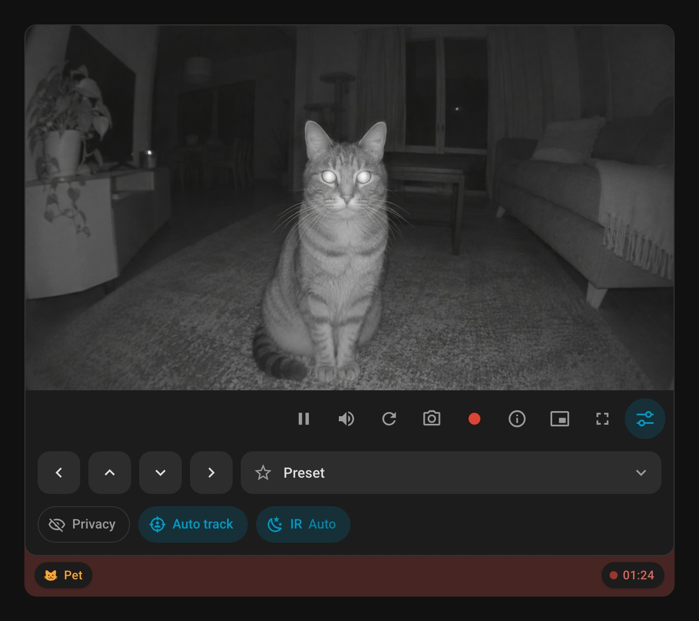

# Speakeasy

[](https://hacs.xyz/)
[](https://github.com/petrouv/ha-speakeasy-card/releases)
[](https://github.com/petrouv/ha-speakeasy-card/actions/workflows/check.yml)

A doorbell, intercom and camera card for Home Assistant: live WebRTC video, push-to-talk microphone and stream quality switching. Built for video doorbells and intercoms with an audio backchannel (Aqara G4, Aqara G400, Reolink Doorbell and similar), but works with any camera served by go2rtc.

<p align="center">
  
  &nbsp;
  
</p>

## Features

- **Push-to-talk.** The microphone is captured only on **Talk**, on the established connection without renegotiation; **Listen** detaches it. A conversation survives automatic reconnects. The microphone is released when the connection drops, you leave the page or switch streams. Failures (no HTTPS, permission denied, the camera does not accept audio) are explained in a notification.
- **Quality switching** over the `streams` list, any number of streams. Labels come from `name`, defaulting to `HD` / `SD` / `LD`. Hidden for a single stream.
- **Control bar under the video**, never over the picture: one row, two rows, or a "more" menu for the least needed buttons on the narrowest cards. Its width never changes, so it never reflows. Colours follow the theme. Pause, sound, reconnect, snapshot, recording, stats, picture-in-picture, fullscreen.
- **Status tray under the card:** event badges (motion, person, doorbell) and the recording timer. It slides out only while something is going on, red while recording, else in the colour of the first event. With `ui: false` the badges sit over the video, without Record or the timer.
- **No layout jumps.** `aspect_ratio` reserves the height up front; in the Sections view the card spans the full width. Only the status tray changes the height; in a fixed-height Sections slot the video gives way to it.
- **Stream stats:** resolution, FPS, bitrate and RTT for WebRTC; mode and resolution for MSE/HLS.
- **Digital zoom** (wheel, pinch, drag), optional PTZ buttons and service shortcuts.
- **Recording** with the [Speakeasy integration](https://github.com/petrouv/ha-speakeasy), see [Recording](#recording).
- **English and Russian UI**, following the Home Assistant user profile.

## Requirements

- The **[WebRTC Camera](https://github.com/AlexxIT/WebRTC)** integration. The card connects to its `/api/webrtc/ws` endpoint, which proxies the stream from the built-in or an external go2rtc; the go2rtc add-on or Home Assistant's built-in go2rtc alone are not enough. Its `webrtc-camera` card is not used and does not conflict.
- **HTTPS** (or `localhost`) for the microphone: browsers require it for `getUserMedia`.
- For talking, a go2rtc stream with an audio backchannel. Audio to the camera goes over WebRTC only, hence the default mode `webrtc`.
- A browser with CSS container queries and `color-mix()`: Chrome / Android WebView 111+, Safari / iOS 16.2+, Firefox 113+. The current Home Assistant companion app qualifies.

## Installation

[](https://my.home-assistant.io/redirect/hacs_repository/?owner=petrouv&repository=ha-speakeasy-card&category=plugin)

Install "Speakeasy — Doorbell, Intercom & Camera Card" and reload the page. Without the button: HACS → ⋮ → Custom repositories → `https://github.com/petrouv/ha-speakeasy-card`, type "Dashboard".

**Manual.** Copy `speakeasy-card.js` to `<config>/www/` and add a dashboard resource (Settings → Dashboards → Resources):

[](https://my.home-assistant.io/redirect/lovelace_resources/)

```yaml
url: /local/speakeasy-card.js?v=0.2.0
type: module
```

Bump `?v=` after every update, otherwise browsers and the app keep the cached copy.

## Example

```yaml
type: custom:speakeasy-card
aspect_ratio: '3:4'
media: video,audio,microphone
streams:
  - url: intercom_hd
    name: HD
  - url: intercom_sd
    name: SD
  - url: intercom_ld
    name: LD
```

`url` is a go2rtc stream name; a Home Assistant camera `entity` works too.

A PTZ camera (Tapo Control entities as an example). Camera controls, presets, toggles and **Talk** go into a panel opened by the last toolbar button; the card remembers its state per browser:

```yaml
type: custom:speakeasy-card
entity: camera.kitchen_hd_stream
media: video,audio,microphone
talk: panel
tools: [volume, reconnect, screenshot, info, pip, fullscreen]
ptz:
  service: button.press
  position: bar
  data_left: {entity_id: button.kitchen_move_left}
  data_up: {entity_id: button.kitchen_move_up}
  data_down: {entity_id: button.kitchen_move_down}
  data_right: {entity_id: button.kitchen_move_right}
preset: select.kitchen_move_to_preset
toggles:
  - entity: switch.kitchen_privacy
    icon: mdi:eye-off-outline
  - entity: switch.kitchen_auto_track
    icon: mdi:target-account
  - entity: select.kitchen_night_vision_switching
    icon: mdi:weather-night
    name: {en: IR, de: IR}
    options:
      auto: {en: Auto, de: Auto}
      'on': {en: 'On', de: Ein}
      'off': {en: 'Off', de: Aus}
    on_states: ['on']
```

A doorbell with a privacy switch, a quick reply (a script that plays a message) and event badges:

```yaml
type: custom:speakeasy-card
url: doorbell_hd
media: video,audio,microphone
toggles:
  - entity: switch.doorbell_privacy
    icon: mdi:eye-off-outline
  - entity: script.doorbell_say_one_minute
    name: {en: One minute, de: Einen Moment}
    icon: mdi:timer-sand
indicators:
  - entity: event.doorbell_ring
    name: {en: Doorbell, de: Klingel}
    icon: mdi:bell-ring
    color: '#ff9800'
  - entity: binary_sensor.doorbell_motion
    icon: mdi:motion-sensor
```

Labels (`name`, `options`) take a string or a map by language code; the card picks the Home Assistant UI language, then `en`, then the first entry. Quote `'on'`, `'off'`, `'On'` and `'Off'`, or YAML reads them as booleans.

## Recording

With the [Speakeasy integration](https://github.com/petrouv/ha-speakeasy) added (**Settings → Devices & services → Add integration**), the toolbar gets a **Record** button without a page reload; removing or disabling the integration hides it the same way. Without the integration, or with a version the card does not support, there is no button and the rest of the card works as usual.

- The integration records on the Home Assistant server, from go2rtc. Closing the page, switching streams or losing the connection does not stop a recording; a card opened later shows it and can stop it.
- The card records the first stream of `streams` (by convention HD), whatever quality is shown. `record_url` overrides it.
- While recording, the button is a red dot and the elapsed time runs in the status tray; a tap stops it.
- Cards (with the control bar) whose first stream (`url` or `entity`, case-insensitive) and `server` match share one recording on any device. `record_url` is not compared: **Record** joins the running recording whatever `record_url` the card sets.
- After **Stop** the file is saved as MP4 (MOV for G.711 sound) to Home Assistant **Media**, in the folder set in the integration options, and downloaded on the device where **Stop** was pressed. The companion app, which may not download files, gets a notification with an **Open** link instead.
- A recording that ends without **Stop** (low disk space, no data from the camera, the stream ended, an error, Home Assistant stopping, the integration reloaded, disabled or removed) is reported once its file is saved, once per page on every device with a card showing it. A page whose card closed, or whose connection dropped, while the file was being saved reports it later, possibly before knowing whether it was saved. A file that could not be saved, after **Stop** too, is reported as lost, or as kept for the integration to save at its next start. Notices name the camera: the card's `title`, else the camera entity's name, else the go2rtc stream name or the camera address without login, path and query. With no card open nothing is shown; for that, automate on the integration's [`speakeasy_recording_finished`](https://github.com/petrouv/ha-speakeasy#event) event.
- A camera that is asleep or offline cannot be recorded: after a few seconds of retrying, the card says it did not answer.

The file keeps the camera's own video and sound, so the go2rtc stream decides what is recorded; see [Setting up camera streams](https://github.com/petrouv/ha-speakeasy#setting-up-camera-streams).

## Options

| Option | Default | Description |
|---|---|---|
| `url` | — | go2rtc stream name or source URL (`rtsp://…`). One of `url`, `entity` or `streams` is required. |
| `entity` | — | Home Assistant camera as the stream source. |
| `streams` | — | Streams for the quality switch, each with `url` or `entity`, optional `name`, `mode`, `media`. The first opens on load. |
| `media` | `video,audio` | What to request: `video`, `audio`, `microphone`. `microphone` adds the **Talk** button. |
| `mode` | `webrtc` | Technologies in order of preference: `webrtc`, `mse`, `hls`, `mjpeg`. Talking works only over `webrtc`. |
| `aspect_ratio` | `16:9` | `'16:9'`, `'3:4'`, `'1920x1080'` or a number (`1.5`). Quote it: YAML reads unquoted `16:9` as the number 969; the card recognises common cases, but not all. |
| `muted` | `false` | Start muted. If the browser blocks autoplay with sound, the card falls back to muted by itself. |
| `ui` | `true` | Show the control bar. `false` leaves the video and the stream technology badge (RTC, MSE…); with the bar the badge shows only while loading or on error. |
| `title` | — | Text in the status line; also names the camera in recording notices. |
| `poster` | — | Image before the video starts: a URL or path (`/local/…`), or a go2rtc stream name for a camera snapshot. |
| `intersection` | `0.75` | Share of the card that must be visible for the stream to start. `0` starts it always. |
| `background` | `false` | Keep streaming while the card is hidden or the tab is inactive. |
| `server` | — | External go2rtc address for the WebRTC Camera integration. |
| `record_url` | — | What **Record** saves instead of the first stream: a go2rtc stream name or source URL. |
| `digital_ptz` | enabled | Digital zoom; `false` disables it. Fine-tuning: `mouse_drag_pan`, `mouse_wheel_zoom`, `mouse_double_click_zoom`, `touch_pinch_zoom`, `touch_drag_pan`, `touch_tap_drag_zoom`, `persist`. |
| `tools` | all | Toolbar buttons, in fixed order: `play`, `volume`, `reconnect`, `screenshot`, `record`, `info`, `pip`, `fullscreen`. Unlisted ones are left out. `record` needs the [Speakeasy integration](https://github.com/petrouv/ha-speakeasy). |
| `talk` | `bar` | Where **Talk** lives (needs `microphone` in `media`): `bar` in the toolbar, `panel` in the camera panel, `false` hidden. |
| `ptz` | — | PTZ buttons: `service` (e.g. `onvif.ptz`), `data_left`, `data_right`, `data_up`, `data_down`, `data_zoom_in`, `data_zoom_out`, `data_home`, `opacity`, `position`. `position: bar` moves them from the video into the camera panel (needs `ui`). |
| `preset` | — | A `select` entity (e.g. camera presets) as a drop-down in the camera panel; choosing calls `select.select_option`. |
| `toggles` | — | Chips in the camera panel: an entity id, or `entity` + `icon` + `name`. A `switch` / `light` / `siren` is toggled (`homeassistant.toggle`) and tinted while `on`. A `select` opens the system picker (`select.select_option`); optional `options` (value → label), `icons` (value → icon), `on_states` (values tinted, default `[on]`). A `script` / `scene` is run and a `button` / `input_button` pressed: these chips are filled, sit in their own top row, tint briefly on tap, and a script stays tinted while it runs. |
| `indicators` | — | Event badges, shown only while active: in the status tray, or over the video with `ui: false`. An entity id, or `entity` + `icon` + `name` + `color` (CSS colour, default red; the first active badge tints the tray unless recording). A `binary_sensor` (or any entity) is active while `on`; an `event` entity for `hold` seconds after its event (default `60`). |
| `shortcuts` | — | Icons over the video: `name`, `icon`, and either `service` + `service_data` or `more_info`. |
| `style` | — | Extra CSS inside the card. Rarely needed. |

`${...}` templates, supported by WebRTC Camera, are intentionally not supported: they were evaluated with `eval`.

## Development

Building the bundle, the source layout and adding a language: see [CONTRIBUTING.md](CONTRIBUTING.md).

## Credits

- [go2rtc](https://github.com/AlexxIT/go2rtc) `video-rtc.js`, the WebRTC/MSE player — AlexxIT, MIT.
- [WebRTC Camera](https://github.com/AlexxIT/WebRTC), the basis of the card and `digital-ptz.js` — AlexxIT, MIT.
- [pan-zoom-controller](https://github.com/dbuezas/pan-zoom-controller), behind the digital zoom — dbuezas; `digital-ptz.js` is taken as distributed with WebRTC Camera.

MIT license, see [LICENSE](LICENSE). Third-party notices: [NOTICE](NOTICE).
